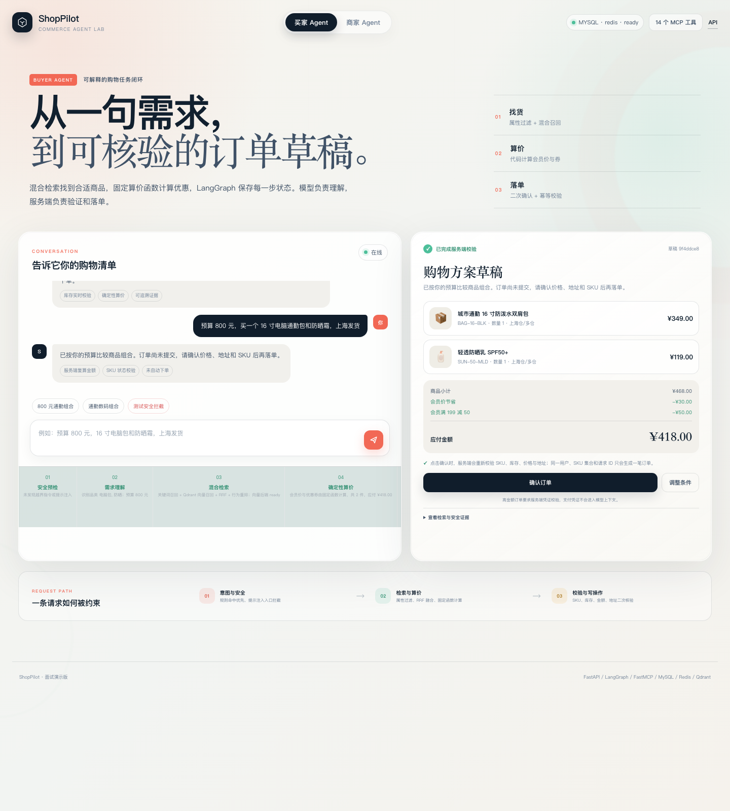
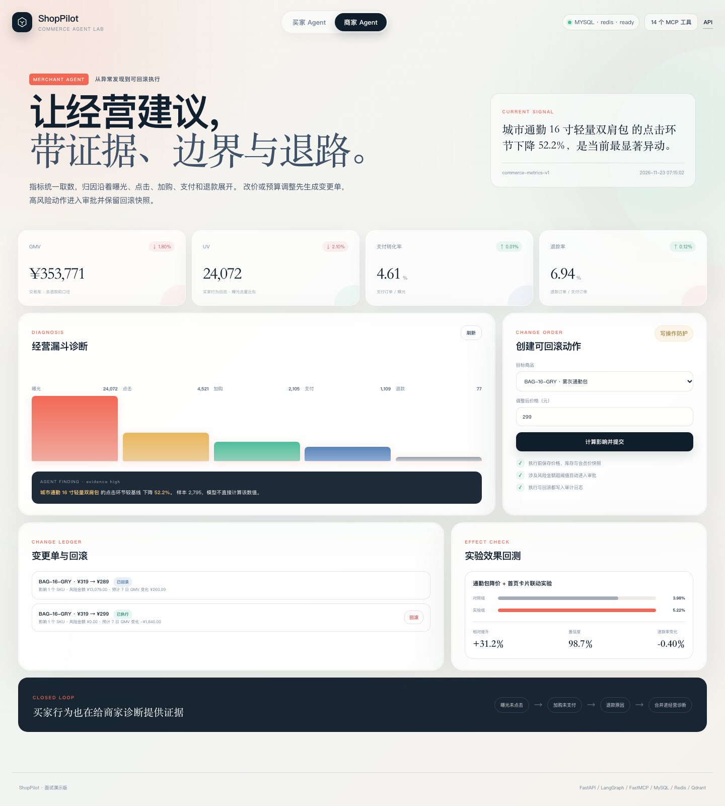
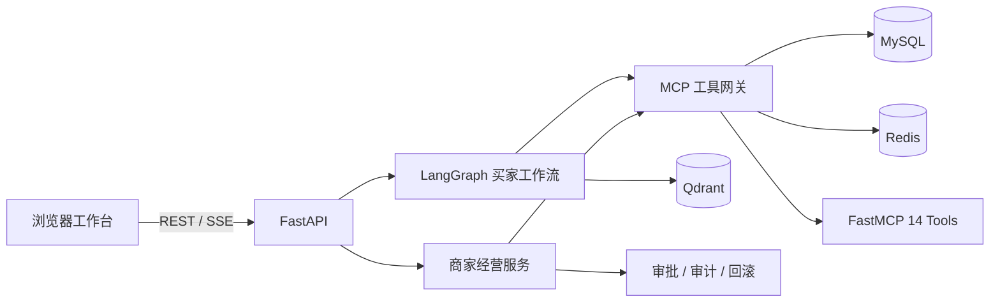

# ShopPilot 电商 Agent 演示平台


**在线演示：** <http://39.107.44.42:8083> ·
[商家工作台](http://39.107.44.42:8083/?view=merchant) ·
[API 文档](http://39.107.44.42:8083/docs)

一个面向 **买家购物** 与 **商家经营** 的可运行 Agent 小项目。它不是只展示聊天能力的 Demo，而是把
“语义理解、工具调用、混合检索、确定性算价、订单安全、经营诊断、审批与回滚”串成了端到端闭环。



## 这个项目想证明什么

- 模型负责理解与表达，金额、库存、指标和合法性由确定性代码负责。
- Agent 的输出不是“看起来合理”，而是带有 SKU 证据、价格明细、数据窗口和安全状态。
- 买家侧不会直接下单；高风险售后需要二次确认并转人工复核。
- 商家侧的建议不会直接改库；先形成变更单，记录影响范围和回滚快照，再审批、执行或回滚。
- 14 个业务工具通过统一网关约束 JSON Schema、角色权限、超时、重试和错误码。

## 功能一览

| 场景 | 可演示能力 |
| --- | --- |
| 买家找货 | 自然语言槽位抽取、类目/预算/尺寸/库存/发货地过滤、关键词 + Qdrant 向量召回、RRF 融合、行为重排 |
| 买家算价 | 会员价、满减券和最优组合由固定函数计算，不交给 LLM |
| 买家下单 | 待确认草稿、服务端二次复算、SKU/库存/地址校验、幂等订单、高金额凭证校验 |
| 买家售后 | 退款/改地址/代下单二次确认，转人工复核，不自动修改订单 |
| 商家指标 | 6 类指标统一定义，覆盖 GMV、UV、支付转化、退款率、加购率和客单价 |
| 商家诊断 | 曝光 → 点击 → 加购 → 支付 → 退款漏斗对比，返回 SKU、时间窗、差值与证据强度 |
| 商家动作 | 改价/活动/预算变更单、预计 GMV 影响、审批阈值、执行前后审计、回滚 |
| 效果回测 | 实验组/对照组转化率、相对提升、退款率变化和置信度 |
| 工程交互 | SSE 事件编号、心跳、断线续传、任务快照续跑、Redis 热上下文、MySQL 持久化、Docker Compose |



## 快速启动

本地默认使用 SQLite 和内存缓存，不需要先安装 MySQL、Redis 或 Qdrant。

```bash
cd shop-pilot-agent
python3 -m venv .venv
source .venv/bin/activate
pip install -r requirements-dev.txt
cp .env.example .env
uvicorn app.main:app --reload --host 0.0.0.0 --port 8000
```

打开：

- 演示页面：<http://127.0.0.1:8000>
- API 文档：<http://127.0.0.1:8000/docs>
- 商家视图：<http://127.0.0.1:8000/?view=merchant>

没有 `DEEPSEEK_API_KEY` 时，系统使用确定性解析器，所有功能仍可完整演示。配置 DeepSeek 后，
模型只补充缺失的语义槽位，规则和硬约束仍然优先。

## 两分钟演示路线

1. 在买家页输入：`预算 800 元，买一个 16 寸电脑通勤包和防晒霜，上海发货`
2. 观察 5 个 LangGraph 节点依次完成，结果出现商品、检索证据和价格明细。
3. 点击“确认订单”，再重复提交一次；服务端返回同一个订单号，演示幂等。
4. 点击“测试安全拦截”，提示注入请求在入口被拒绝。
5. 切换到商家侧，查看灰色通勤包点击下降约 52% 的漏斗诊断。
6. 提交 `BAG-16-GRY` 改价到 299 元，观察变更单进入审批、执行和回滚。

## 架构



买家流程：

```text
安全预检 → 槽位抽取 → 约束过滤 + 混合召回 → 确定性算价
→ 待确认草稿 → 服务端后置校验 → SSE 输出
```

商家流程：

```text
指标语义层 → 五段漏斗对比 → 异常 SKU 与证据强度
→ 变更单预演 → 审批阈值 → 执行 → 审计 → 回滚
```

## 代码索引

| 路径 | 内容 |
| --- | --- |
| `app/main.py` | FastAPI 路由、鉴权、SSE、商家与工具接口 |
| `app/buyer_service.py` | LangGraph 工作流、会话记忆、订单确认、幂等 |
| `app/merchant_service.py` | 指标语义层、诊断、变更单、实验与日报 |
| `app/tool_gateway.py` | 14 个工具、JSON Schema、角色范围、超时重试、错误码 |
| `app/mcp_server.py` | FastMCP HTTP 服务 |
| `app/retrieval.py` | 约束过滤、关键词/向量召回、RRF、行为重排 |
| `app/pricing.py` | 会员价、优惠券和组合选择的固定函数 |
| `app/models.py` | MySQL/SQLite 数据模型 |
| `app/static/` | 无前端框架依赖的演示工作台 |
| `tests/` | 买家、安全、幂等、商家、工具权限测试 |

## MCP 服务

```bash
# 先启动主服务完成数据库初始化
python -m app.mcp_server
```

本地默认监听 `http://127.0.0.1:8001/mcp`。工具需要演示 JWT，可通过以下接口获取：

```bash
curl 'http://127.0.0.1:8000/api/auth/demo-token?role=merchant'
```

在支持 Streamable HTTP 的 MCP 客户端中配置 URL 即可。生产环境通过 Nginx 的 `/mcp`
路径访问，不直接暴露 8001 端口。

## Docker Compose

```bash
cp .env.example .env
# 修改 SECRET_KEY、MYSQL_PASSWORD、MYSQL_ROOT_PASSWORD、REDIS_PASSWORD
docker compose up -d --build
curl http://127.0.0.1/api/health
```

Compose 包含 MySQL、Redis、Qdrant、FastAPI、FastMCP 和 Nginx。数据库、缓存和向量数据使用
命名卷持久化。

当前阿里云实例采用独立的低资源部署文件
`deploy/docker-compose.ecs.yml`：复用服务器已有的 MySQL，单独运行 Redis、Qdrant、
FastAPI、FastMCP 和 Nginx，公网端口为 `8083`。

## 测试与质量

```bash
make check
```

当前覆盖：

- 买家完整找货到订单草稿
- 价格与 SKU 结果校验
- 重复下单幂等
- 提示注入拦截
- 售后二次确认与人工复核
- 中断任务从持久化节点快照继续执行
- 商家异常诊断
- 变更单审批、执行、回滚
- 14 个工具数量与角色权限
- 实验和日报接口

## 设计边界

这是面试演示项目，而不是完整商业系统：

- 商品、订单和经营数据均为可重复的演示数据。
- 本地向量使用确定性哈希嵌入，生产环境可替换为真实 embedding 服务。
- DeepSeek 只负责槽位补全；没有 Key 时自动降级为规则解析。
- 演示鉴权使用固定买家/商家身份，生产环境应接入真实 IAM。
- 支付、短信、物流和 ERP 均为模拟工具；验证的是业务流程与安全边界。
- MySQL 表由演示启动过程自动创建；正式迭代应引入 Alembic 迁移。

## 文档

- [项目完整讲解](docs/PROJECT_GUIDE.md)
- [简历能力映射](docs/RESUME_MAPPING.md)
- [面试演示与问答稿](docs/INTERVIEW_SCRIPT.md)

## License

MIT

## CI 配置

`ci/github-actions.example.yml` 保留了 GitHub Actions 配置模板。
